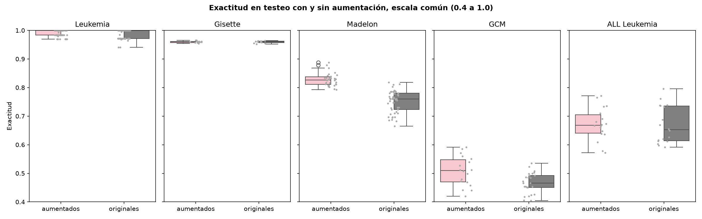
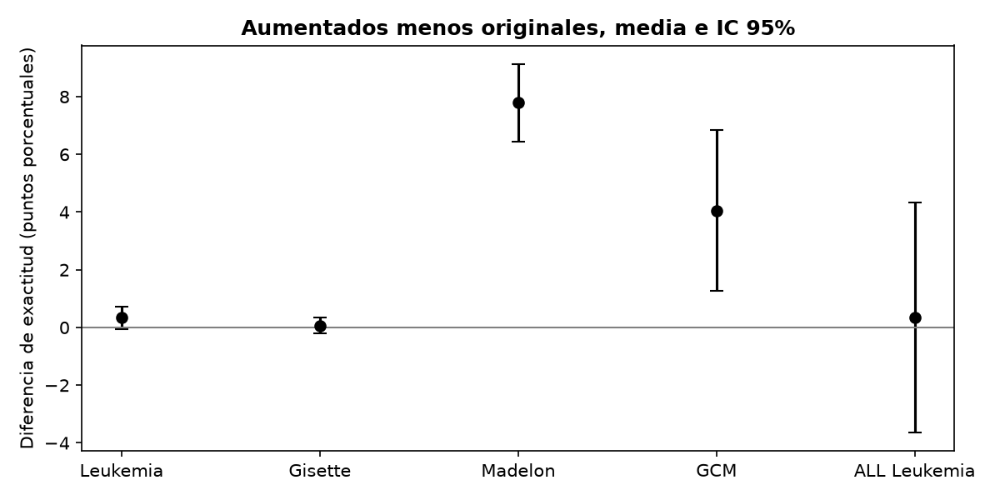

# Respuesta a las observaciones del jurado

10 de octubre de 2026 · Claudio Sebastian Castillo

## Contexto

Los dos evaluadores aceptaron la tesis para su defensa oral y pública sin pedir correcciones al documento. Sus observaciones son sugerencias para la defensa, no condiciones. Este documento prepara una respuesta por cada observación.

| Evaluador | Institución | Observaciones |
| --- | --- | --- |
| Dr. Facundo Manuel Quiroga | Facultad de Informática, UNLP | (a) comparar con el estado del arte del capítulo 2, (b) comparar con SMOTE y otros métodos de aumentación, (c) unificar escalas en los gráficos de exactitud, (d) analizar primero los resultados de forma global |
| Dra. Débora Chan | Universidad Austral | (e) definir qué significa "mejora en la selección de características", (f) enfatizar limitaciones de generalización y moderar conclusiones donde las diferencias no fueron significativas |

Cada respuesta tiene dos partes. **Para el jurado** es el texto que podés decir o poner en una diapositiva. **Para vos** explica de dónde sale, qué datos de la tesis lo respaldan y qué conviene no decir.

## Respuestas

La respuesta de fondo es una sola: la aumentación con AV mejora la selección con AG cuando el problema está lejos de saturar y el AV reconstruye bien los datos. En Madelon y GCM la mejora es significativa. En Leukemia, Gisette y ALL Leukemia no hay diferencia significativa de exactitud, y lo único que puede defenderse es una menor dispersión y subconjuntos algo más chicos.

### (a) Comparación con el estado del arte del capítulo 2 y otros

**Para el jurado.** La tesis compara contra dos referencias internas. La primera es el mismo AG sin aumentación, con idénticos parámetros, que es la comparación que responde a la hipótesis. La segunda son los modelos clásicos del capítulo 2 sobre el espacio completo de características. Esa segunda comparación tiene una limitación que conviene decir de frente: el capítulo 2 reporta AUC y macro-F1 sobre una partición 80/20 propia, mientras que el capítulo 4 reporta exactitud sobre la partición original de testeo. Por eso la comparación válida dentro de la tesis es con el MLP del capítulo 3 entrenado con datos reales en las particiones originales. Frente a esa referencia, el flujo AV+AG iguala o supera la exactitud en los cinco conjuntos, usando entre el 0,6% y el 10% de las características originales.

| Conjunto | MLP, todas las características (cap. 3) | AG sin aumentación | AG con aumentación | Características usadas por el AG |
| --- | --- | --- | --- | --- |
| Leukemia | 0,81 | 0,989 | 0,992 | 30 a 680 de 7.129 |
| Gisette | 0,97 | 0,959 | 0,960 | 437 y 424 de 5.000 |
| Madelon | 0,55 | 0,750 | 0,828 | 36 y 29 de 500 |
| GCM | 0,54 | 0,497 | 0,541 | 450 a 780 de 16.063 |
| ALL Leukemia | sin medición en cap. 3 | 0,669 | 0,672 | 35 a 300 de 12.600 |

Frente a la literatura externa, la comparación honesta es esta. En GCM, Ramaswamy et al. (2001) reportan 78% de exactitud con SVM uno contra todos usando los 16.063 genes. Nuestro 54% se obtiene con 450 a 780 genes y una función de aptitud que penaliza el número de características con peso 0,5, de modo que el AG sacrifica exactitud a cambio de dimensionalidad por diseño. En Madelon, los ganadores del desafío NIPS 2003 llegaron a una tasa de error balanceado cercana a 0,07, es decir unos 93% de exactitud balanceada, con redes bayesianas y árboles de difusión de Dirichlet. Nuestro 83% con 29 características es un resultado intermedio, superior a 16 de los 18 clásicos del capítulo 2. En Leukemia, Golub et al. (1999) resolvieron el problema con 50 genes, y nuestros resultados con 30 a 65 genes están en el mismo rango de exactitud casi perfecta.

**Para vos.** El objetivo de la tesis nunca fue superar al estado del arte en exactitud absoluta, sino medir el impacto de la aumentación sobre un mismo AG. Decilo así en la primera diapositiva de resultados para que el jurado no espere otra cosa. Los números de la tabla salen del archivo de experimentos del repo, no de las tablas de la tesis, y coinciden con ellas salvo redondeo. La cifra de 78% de Ramaswamy la verifiqué en el resumen del artículo. La cifra de NIPS 2003 (error balanceado cercano a 0,07) aparece citada en trabajos posteriores, pero no pude abrir la tabla oficial del desafío. Verificala en Guyon et al. (2004), *Result analysis of the NIPS 2003 feature selection challenge*, antes de ponerla en una diapositiva. El dato de Golub (50 genes) es de memoria del artículo original. Si Quiroga insiste en una tabla con el capítulo 2, mostrá la Tabla 2.1 junto a la de arriba y aclará que las métricas y particiones difieren. No conviertas AUC en exactitud.

### (b) Comparación con SMOTE y otros métodos de aumentación

**Para el jurado.** La tesis no ejecutó SMOTE, y es una limitación que se reconoce. La elección de AV sobre SMOTE se apoyó en tres resultados de la literatura que la tesis cita. Blagus y Lusa (2013) mostraron que SMOTE no aporta beneficios en datos de alta dimensionalidad con pocas muestras, salvo que se haga selección de variables antes, porque interpola en un espacio donde las distancias pierden sentido. Fajardo et al. (2021) compararon sobremuestreo aleatorio, SMOTE, GAN y AV condicional sobre versiones desbalanceadas de MNIST y Fashion MNIST, y el AV condicional fue el mejor generador. Ai et al. (2023) confirmaron que los AV guiados superan a otros métodos de sobremuestreo en datos tabulares y de imágenes. Además, SMOTE se diseñó para rebalancear clases, no para aumentar el total de muestras en problemas balanceados como Madelon o Gisette, que es el uso que la tesis le da a la aumentación. Un estudio comparativo AV contra SMOTE dentro del mismo flujo con AG queda como trabajo futuro inmediato.

**Para vos.** La referencia de Blagus y Lusa es la más fuerte, porque es justamente el escenario de Leukemia, GCM y ALL Leukemia. Está en tu bibliografía como la cita de SMOTE del capítulo 1, así que podés nombrarla sin riesgo. Si tenés tiempo antes de la defensa, un experimento rápido con SMOTE sobre Madelon (mismo AG, mismos parámetros, 2.000 muestras sintéticas con SMOTE en lugar del AV) te daría una diapositiva de respaldo. El código del AG está en el repo ealab, no en este. Si no llegás, la respuesta de arriba alcanza, porque el jurado lo planteó como sugerencia y no como condición.

### (c) Unificar las escalas en los gráficos de exactitud

**Para el jurado.** Tiene razón. La Figura 4.16 usa un eje vertical distinto en cada panel, de 0,94 a 1,00 en Leukemia y de 0,952 a 0,965 en Gisette, lo que agranda visualmente diferencias que no son significativas. Para la defensa se preparan dos gráficos. El primero repite los cinco conjuntos con un eje común de 0,4 a 1,0, donde se ve que en Leukemia y Gisette las cajas se superponen y en Madelon y GCM se separan. El segundo muestra la diferencia de exactitud entre aumentados y originales en puntos porcentuales, con su intervalo de confianza del 95%, que es la forma más directa de ver dónde el efecto existe. Los dos gráficos están en la sección de datos de este documento.

**Para vos.** Los dos gráficos ya están generados en la carpeta de la tesis, con los nombres que figuran en la sección de datos, a partir del archivo de experimentos del repo. Mostrá el de escala común primero y el de diferencias después. Un detalle menor: las figuras de la tesis dicen "Precisión" en el eje, pero la métrica es exactitud (accuracy). En los gráficos nuevos ya dice exactitud. Si alguien lo señala, reconocelo como error de rótulo.

### (d) Analizar primero los resultados de forma global

**Para el jurado.** La presentación de resultados se ordena en tres pasos antes de entrar en cualquier conjunto de datos. Primero, una sola tabla con los cinco conjuntos, su dificultad, la exactitud con y sin aumentación, la diferencia y si fue significativa. Segundo, el gráfico de diferencias con intervalos de confianza. Tercero, la regla que resume todo: donde el problema está saturado la aumentación no cambia la exactitud, y donde hay margen y el AV reconstruye bien, la aumentación mejora. Recién después se profundiza en los dos casos que explican la regla, Madelon por el ruido y GCM por el desbalance multiclase y el flujo selección-generación-selección. Leukemia, Gisette y ALL Leukemia quedan como diapositivas de respaldo.

**Para vos.** Esto cambia el orden de tus diapositivas, no el contenido. La tabla global está lista en la sección de datos. Dedicá a GCM el tiempo que le des a la metodología, porque es donde está el aporte propio (la primera etapa falló, el diagnóstico con la Tabla 4.4 y el flujo encadenado). Madelon es tu mejor resultado y el más fácil de explicar.

### (e) Qué significa "mejora en la selección de características"

**Para el jurado.** La tesis define la mejora con tres criterios operativos, enunciados en la metodología del capítulo 4, y conviene mantenerlos separados porque no se mueven juntos. El primero es el desempeño predictivo: exactitud en la partición original de testeo del mejor subconjunto que encuentra el AG. El segundo es la reducción de variables: número medio de características seleccionadas en la población final, que la función de aptitud penaliza con el mismo peso que la exactitud. El tercero es la estabilidad: dispersión de la exactitud y del número de características entre corridas independientes del AG, medida por desviación estándar y rango intercuartílico. Con esa definición, el balance por conjunto es el siguiente.

| Conjunto | Desempeño predictivo | Reducción de variables | Estabilidad de la exactitud |
| --- | --- | --- | --- |
| Leukemia | sin diferencia (0,992 vs 0,989, p = 0,09) | igual (259 vs 259) | mejora (desv. 0,011 vs 0,016) |
| Gisette | sin diferencia (0,960 vs 0,959, p = 0,63) | mejora (424 vs 437) | mejora leve (desv. 0,003 vs 0,004) |
| Madelon | mejora (0,828 vs 0,750, p < 0,001) | mejora (29 vs 36) | mejora (desv. 0,023 vs 0,038) |
| GCM | mejora (0,541 vs 0,497, p = 0,005) | igual (454 vs 462; 785 vs 781) | empeora (desv. 0,052 vs 0,036) |
| ALL Leukemia | sin diferencia (0,672 vs 0,669, p = 0,87) | igual (174 vs 173) | mejora leve (desv. 0,056 vs 0,065) |

**Para vos.** La distinción que pide Chan te favorece, porque permite decir con precisión qué mejoró en cada caso en lugar de un "mejora" genérico. Fijate que en GCM la exactitud mejora pero la dispersión aumenta. Decilo antes de que te lo pregunten: con 5 corridas por configuración y un test de 57 muestras, cada muestra mal clasificada mueve la exactitud 1,75 puntos. La desviación estándar y el p de la tabla los recalculé desde el archivo de experimentos con un test de Welch, usando como n la cantidad de corridas del AG. Las medias coinciden con la tesis.

### (f) Limitaciones de generalización y conclusiones moderadas

**Para el jurado.** Las conclusiones que se sostienen con evidencia significativa son dos: Madelon y GCM en su segunda etapa. En Leukemia, Gisette y ALL Leukemia la aumentación no cambió la exactitud de forma significativa, y lo que se observa es una menor dispersión y, en Gisette y Madelon, subconjuntos algo más compactos. Las limitaciones de generalización son cinco. Primera, son cinco conjuntos de datos, dos de ellos artificiales, y el efecto depende de la dificultad del problema. Segunda, el número de corridas en GCM y ALL Leukemia es bajo, entre 5 y 10 por configuración, y las particiones de testeo son chicas. Tercera, el efecto depende de la calidad del AV: en la primera etapa de GCM, con el AVC sobre las 16.063 variables, la aumentación empeoró la exactitud (0,512 contra 0,538), y recién mejoró al generar sobre un subespacio seleccionado. Cuarta, hay un umbral de muestras sintéticas más allá del cual el resultado se degrada, como se vio con 6.000 muestras en GCM. Quinta, la función de aptitud usa un solo clasificador, un MLP, y los hiperparámetros del AG se ajustaron por conjunto de datos, así que los valores no se transfieren a otros problemas sin reajuste.

**Para vos.** Hay tres frases de la tesis que conviene moderar en la defensa. En ALL Leukemia la tesis dice que la combinación "incrementa la precisión de manera consistente" cuando se reducen las variables, pero los datos muestran diferencias de +1,7 y +0,9 puntos con p mayor a 0,4, y con 300 genes activos los originales fueron mejores (0,754 contra 0,735). Decí "no se observaron diferencias significativas; la tendencia favorable en 35 y 180 genes no alcanza significación". En GCM el salto de 9% es relativo (de 0,497 a 0,541); en puntos porcentuales son 4,4. Conviene dar los dos números. En Madelon el 10,4% también es relativo; son 7,8 puntos porcentuales. Un punto delicado: el script que respaldó la significación en GCM usó como tamaños muestrales 3.133 y 133, que son las cantidades de observaciones de los datasets, no de corridas del AG. Ese test estaba mal planteado. Lo recalculé con las corridas reales (9 aumentadas, 10 originales) y la diferencia sigue siendo significativa (p = 0,005 con Welch, p = 0,006 con Mann-Whitney), y también si se toman las 18 contra 25 corridas de toda la segunda etapa (p = 0,008). Así que la conclusión se sostiene, pero si te preguntan por el test, respondé con estos números y no con los de la tesis.

## Datos de respaldo

Todo lo que sigue sale del archivo de experimentos del repo (`utnthesis/filtered_experiment_data_v2.csv`), recalculado el 10 de octubre de 2026. Cada fila de ese archivo es una corrida completa del AG. La exactitud es la media de la población final sobre la partición original de testeo. El valor p es de un test t de Welch entre corridas aumentadas y originales; Mann-Whitney da la misma conclusión en todos los casos.

### Tabla global para la primera diapositiva de resultados

| Conjunto | Dificultad | Corridas (aum. / orig.) | Exactitud orig. | Exactitud aum. | Diferencia (pp) | p | Lectura |
| --- | --- | --- | --- | --- | --- | --- | --- |
| Leukemia | 72 x 7.129, binario, desbalanceado | 90 / 90 | 0,989 | 0,992 | +0,3 | 0,09 | saturado, sin cambio |
| Gisette | 13.500 x 5.000, binario, ruido | 13 / 12 | 0,959 | 0,960 | +0,1 | 0,63 | saturado, sin cambio |
| Madelon | 2.000 x 500, binario, 480 variables de ruido | 30 / 49 | 0,750 | 0,828 | +7,8 | < 0,001 | mejora significativa |
| GCM (2.ª etapa, 450 a 780 genes) | 190 x 16.063, 14 clases desbalanceadas | 9 / 10 | 0,497 | 0,541 | +4,4 | 0,005 | mejora significativa |
| GCM (2.ª etapa, todas las configuraciones) | ídem | 18 / 25 | 0,467 | 0,507 | +4,0 | 0,008 | mejora significativa |
| ALL Leukemia | 327 x 12.600, 14 clases desbalanceadas | 18 / 18 | 0,669 | 0,672 | +0,3 | 0,87 | sin cambio |

### Desglose por tamaño de cromosoma en los multiclase

| Conjunto y genes activos | Corridas (aum. / orig.) | Exactitud orig. | Exactitud aum. | p |
| --- | --- | --- | --- | --- |
| GCM ~45 | 3 / 7 | 0,439 | 0,451 | 0,42 |
| GCM ~200 | 6 / 8 | 0,454 | 0,485 | 0,24 |
| GCM ~450 | 5 / 5 | 0,489 | 0,538 | 0,04 |
| GCM ~750 | 4 / 5 | 0,505 | 0,545 | 0,10 |
| ALL Leukemia ~35 | 5 / 5 | 0,608 | 0,625 | 0,48 |
| ALL Leukemia ~180 | 8 / 8 | 0,654 | 0,663 | 0,65 |
| ALL Leukemia ~300 | 5 / 5 | 0,754 | 0,735 | 0,40 |

### Gráficos nuevos para la defensa

Eje común de 0,4 a 1,0 para los cinco conjuntos.

Diferencia de exactitud aumentados menos originales, en puntos porcentuales, con intervalo de confianza del 95%. Donde la barra cruza el cero no hay evidencia de efecto.

### Referencias externas citadas en la respuesta (a)

| Referencia | Dato | Estado |
| --- | --- | --- |
| [Ramaswamy et al., PNAS 2001](https://pmc.ncbi.nlm.nih.gov/articles/PMC64998) | GCM, 78% de exactitud con SVM sobre 16.063 genes, contra 9% al azar | verificado en el resumen |
| [Guyon et al., NIPS 2004](https://proceedings.neurips.cc/paper/2004/hash/5e751896e527c862bf67251a474b3819-Abstract.html) | Madelon, error balanceado de los ganadores cercano a 0,07 | citado en trabajos posteriores; confirmar en la tabla del artículo |
| Golub et al., Science 1999 | Leukemia, clasificador con 50 genes | de memoria; confirmar |
| Blagus y Lusa, BMC Bioinformatics 2013 | SMOTE no beneficia en alta dimensionalidad con pocas muestras | ya citado en la tesis, capítulo 1 |
| Fajardo et al., 2021 | AV condicional supera a SMOTE y GAN en MNIST desbalanceado | ya citado en la tesis, capítulo 3 |

## Cambios pendientes

Ninguno es obligatorio: la tesis fue aceptada sin correcciones. Son ajustes para que lo que digas en la defensa coincida con lo escrito, por si el jurado los pide después.

- [ ] Capítulo 4, sección ALL Leukemia, y capítulo 5: reemplazar "incrementa la precisión de manera consistente" por "muestra una tendencia favorable que no alcanza significación estadística".
- [ ] Capítulo 4, GCM segunda etapa: junto al 8,85% relativo, agregar "4,4 puntos porcentuales" y el número de corridas (9 y 10).
- [ ] Capítulo 4, Madelon: junto al 10,4% relativo, agregar "7,8 puntos porcentuales".
- [ ] Script `analisis_significancia_precision_gcm.py`: corregir los tamaños muestrales de 3.133 y 133 a 9 y 10 corridas. El resultado sigue siendo significativo.
- [ ] Figura 4.16: reemplazar por la versión de escala común, o agregar la figura de diferencias con intervalos de confianza.
- [ ] Figuras 4.7 a 4.15: cambiar el rótulo "Precisión" por "Exactitud" en el eje vertical.
- [ ] Opcional, si hay tiempo: experimento con SMOTE en Madelon con el mismo AG, para la diapositiva de respaldo de la respuesta (b).
